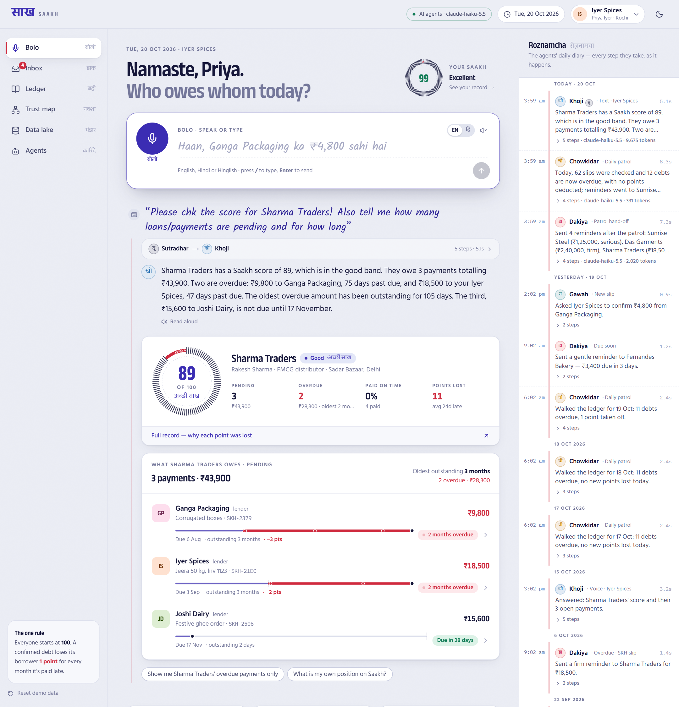
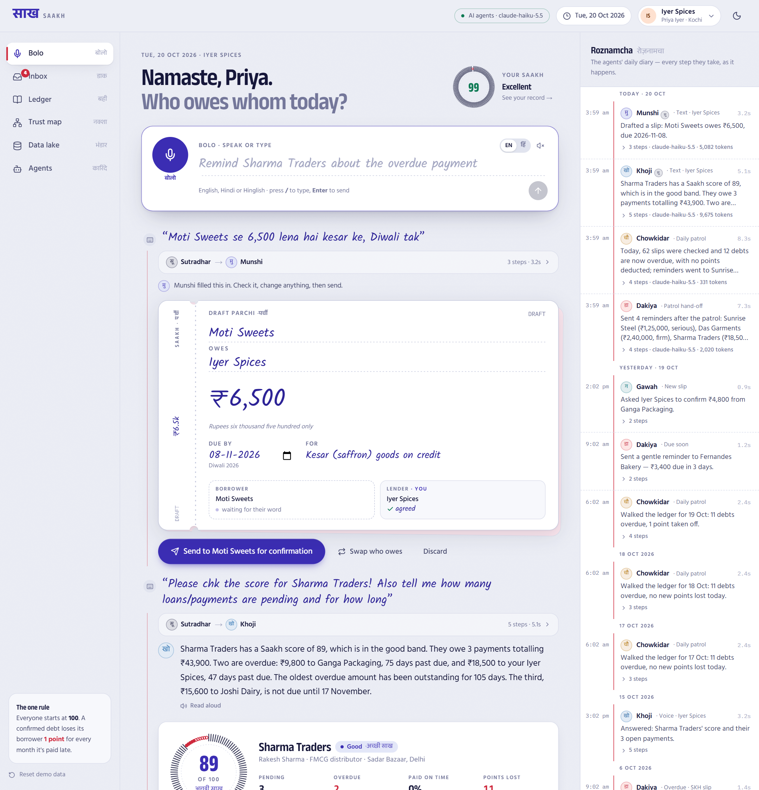
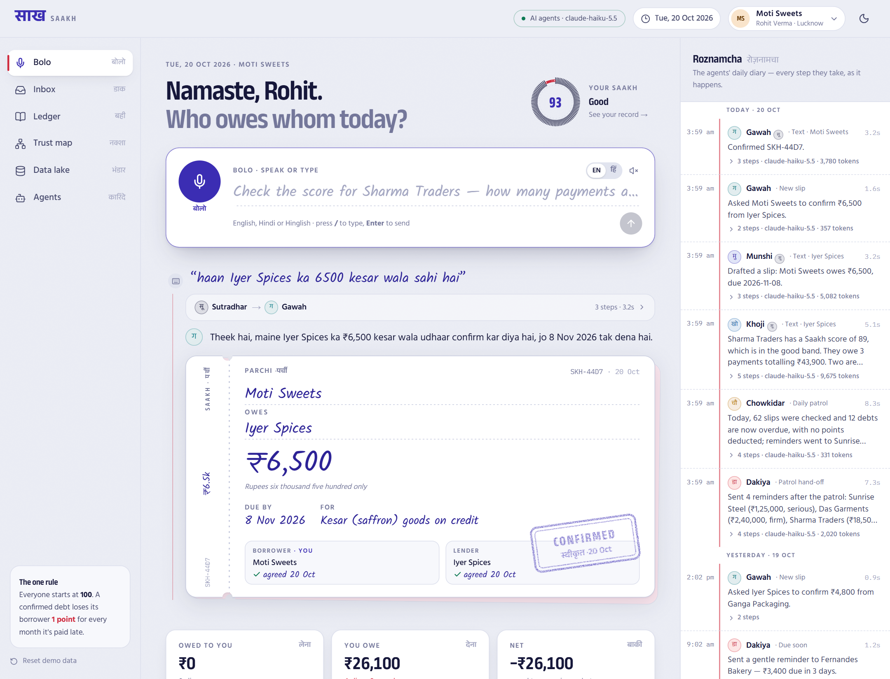
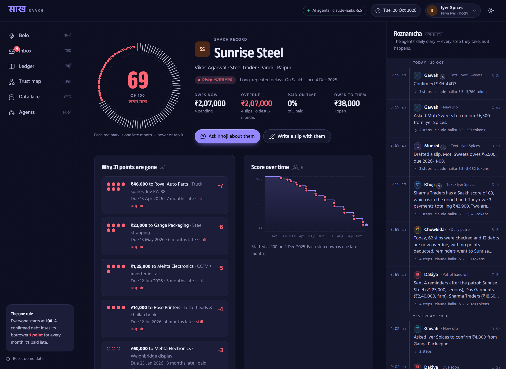
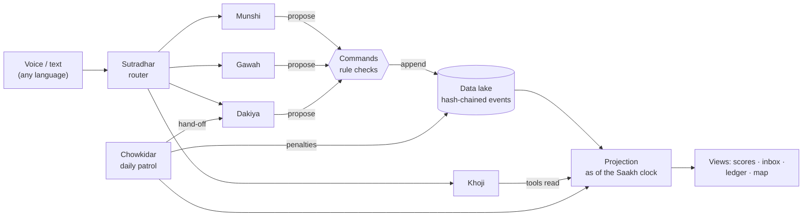
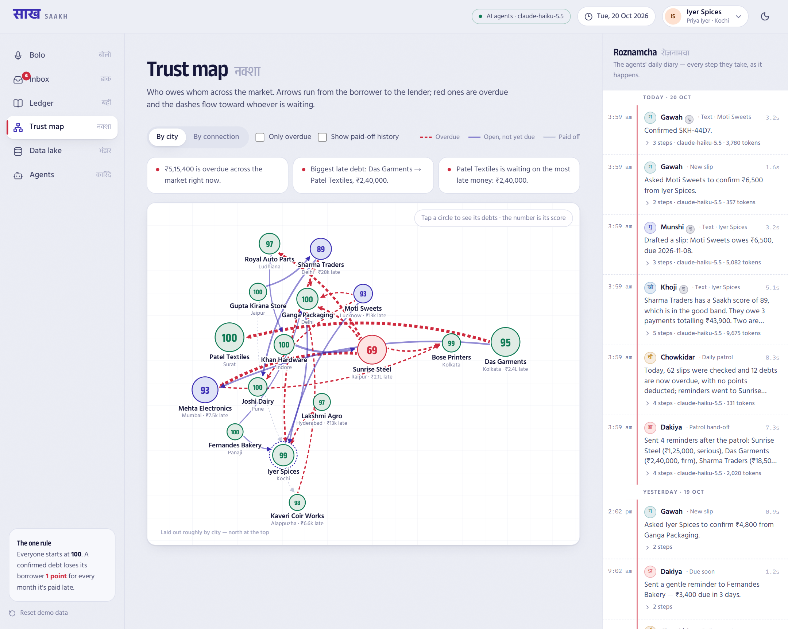
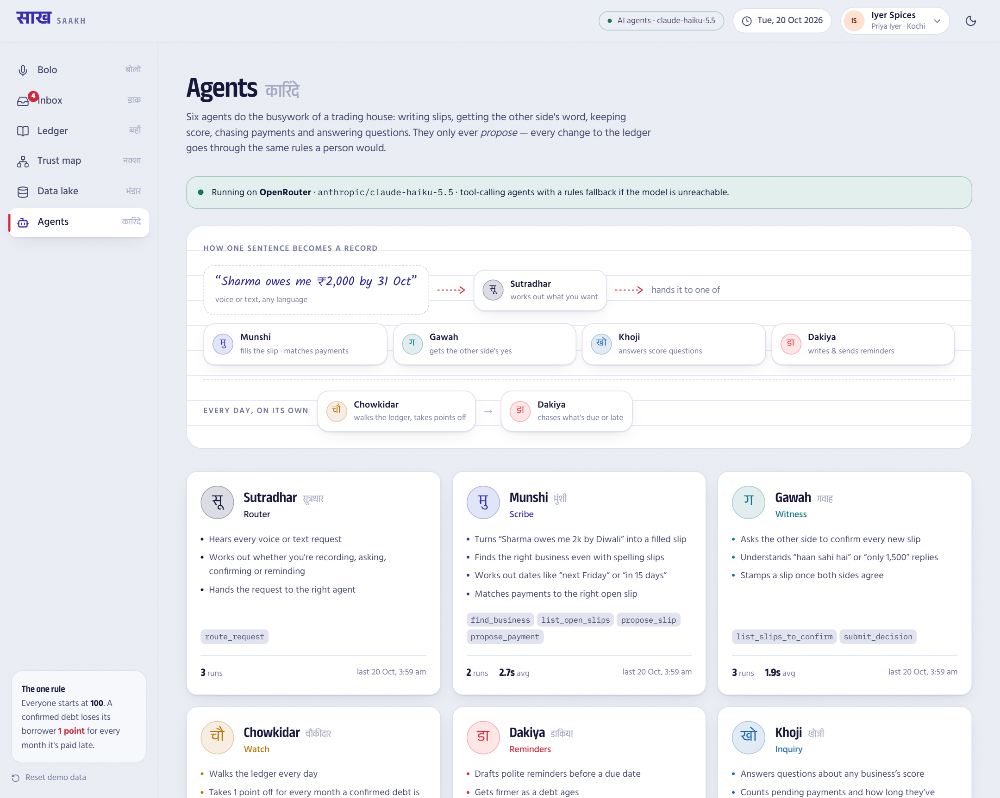
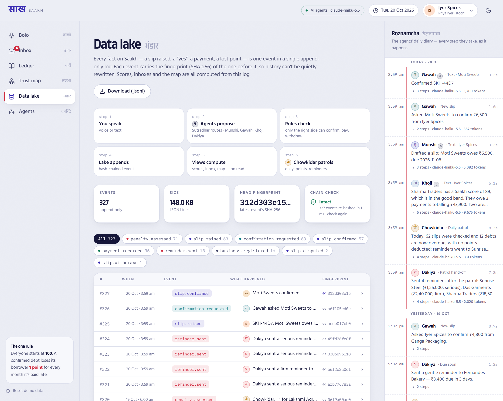
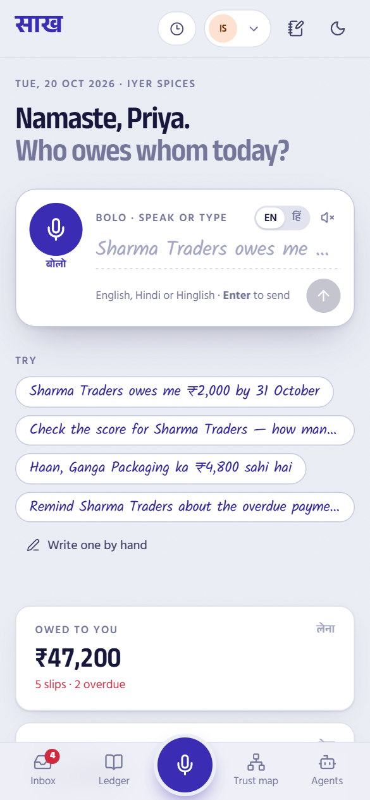

# साख · Saakh — your word, on record

**Saakh** (Hindi/Urdu for *creditworthiness, reputation*) is a shared credit ledger for India's small businesses.

A seller says *"Sharma Traders owes me ₹2,000 by 31 October."* The buyer answers *"haan, sahi hai."* From that moment the debt is on a common record that neither side can quietly rewrite. If the due date passes unpaid, the buyer's **Saakh score** (everyone starts at 100) drops by one point for every month of delay. Anyone can then ask, by voice or text, *"Check the score for Sharma Traders — how many payments are pending, and for how long?"* and get a spoken answer with the receipts.

Six AI agents do all the busywork: they fill in the slips, get the other side's word, keep score, chase payments and answer questions.



---

## The brief, and how Saakh meets it

| The brief asked for | What Saakh does |
| --- | --- |
| Vendor/buyer records a transaction with a simple click | Speak or type one sentence in English, Hindi or Hinglish. **Munshi** turns it into a filled *parchi* (slip); you tap **Send** once. A plain form also exists for anyone who'd rather not talk. |
| "X says Y owes me Rs 2000 by Oct 31" | Amounts like *2k, do hazaar, dhai hazaar, 1.2 lakh*; dates like *by the 31st, 15 din mein, next Friday, Diwali tak*; misspelt names (*"sharmaa tradrs"*). Businesses that aren't on Saakh yet are invited by the slip. |
| Buyer confirms by saying yes | The slip lands in the buyer's inbox. They tap **Confirm**, or just say *"haan, Iyer Spices ka 2000 sahi hai"*. **Gawah** works out which slip they mean and stamps it. They can also dispute it or counter with a different amount, and the lender accepts or withdraws. **Nothing counts until both sides agree.** |
| Goes into a central data lake | Every fact is an event in one **append-only, SHA-256 hash-chained log** (the *Data lake* page shows it, verifies the chain and exports it). Scores and inboxes are computed from it, never typed in. |
| Score starts at 100, −1 for every month of delay | Implemented exactly; see [the rule](#the-scoring-rule). **Chowkidar** walks the ledger every day, records each lost point and explains it. Hover any red mark on a score ring to see which debt cost it. |
| Searchable by voice/text: score + pending loans + how long | **Khoji** answers using tools over the ledger: the score, points lost and why, how many payments are pending, the total, how many are overdue, and how long each has waited. It speaks the answer aloud and shows the evidence as cards. |
| AI-native, agentic AI doing the busywork | Six tool-calling agents on **OpenRouter** (Claude Haiku 5.5 by default). A live diary (*Roznamcha*) shows every step and tool call as it happens. |
| Your choice of UX ("Google Maps etc.") | A **Trust map** of who owes whom across India, a **time machine** to fast-forward the clock and watch scores fall, rubber-stamp confirmations, postcard reminders, and full dark mode and mobile layouts. |

---

## The agents

Each one is named after the person who did this job in a traditional Indian trading house.

| Agent | Job | Tools |
| --- | --- | --- |
| **सूत्रधार Sutradhar** · Router | Hears every request and hands it to the right agent | `route_request` |
| **मुंशी Munshi** · Scribe | Sentence → filled slip; matches "Fernandes ne 3,400 de diye" to the right open slip | `find_business`, `list_open_slips`, `propose_slip`, `propose_payment` |
| **गवाह Gawah** · Witness | Asks the other side to confirm each new slip; reads their reply (yes / no / "only 1,500") | `list_slips_to_confirm`, `submit_decision` |
| **चौकीदार Chowkidar** · Watch | Daily patrol: takes points off late debts, picks who needs chasing, writes a patrol report | `scan_ledger`, `assess_penalty`, `write_report` |
| **डाकिया Dakiya** · Reminders | Writes WhatsApp-style reminders that get firmer as a debt ages, and delivers them | `draft_reminder`, `deliver` |
| **खोजी Khoji** · Inquiry | Answers questions about any business or the market and picks which evidence cards to show | `find_business`, `get_trust_profile`, `list_obligations`, `market_overview`, `my_position`, `answer` |

**Agents propose; rules decide.** The agents only read through tools. Every change to the ledger goes through the same command checks a person's tap would: only the borrower can confirm a lender's slip, only the lender can confirm a payment arrived, and so on. Each agent ends by calling a structured "final" tool, so its output is typed data, not free text. Answer cards are filled from the ledger, never from the model's words, so a number on screen can't be hallucinated.

**It keeps working without AI.** If there's no API key, or the model is unreachable, every agent falls back to a built-in rules engine (amount, date and name parsing, keyword routing). The top bar says which mode you're in.




---

## The scoring rule

```
score = max(0, 100 − total late months across all confirmed debts)
```

* Only **confirmed** debts count. A slip one side hasn't agreed to, or has disputed, affects no one.
* A debt still unpaid the day after its due date costs the borrower **1 point**, and **1 more at the start of every further month**.
  A debt due **31 Oct** loses its 1st point on **1 Nov**, its 2nd on **1 Dec**, and so on (calendar months, clamped at month-end).
* Paying stops the clock. Points already lost **stay lost**; that's the record.
* If a borrower says they paid, the payment date counts once the lender confirms the money arrived. Points lost while waiting for that confirmation are given back.

The rule lives in one function: [`src/lib/shared/score.ts`](src/lib/shared/score.ts). Scores are derived from the event log on every read, so they can't drift from the facts.

**Bands:** 95–100 Excellent (पक्की साख) · 85–94 Good · 70–84 Watch · below 70 Risky.



---

## Architecture



* **Event sourcing.** [`store.ts`](src/lib/server/store.ts) appends events to `lake.jsonl`, or to Postgres when `DATABASE_URL` is set. Each one carries `hash = sha256(prev ‖ seq, type, at, actor, data)`, so changing any past event breaks every hash after it. `/api/lake/verify` re-hashes the whole chain.
* **Projection.** [`project.ts`](src/lib/server/project.ts) folds the events into businesses and slips *as of* a moment, and [`views.ts`](src/lib/server/views.ts) derives scores, inboxes, profiles and the network graph.
* **Time machine.** Because state is a fold "as of" the Saakh clock, moving the clock forward (or back) is just a different fold. Chowkidar patrols the new day and Dakiya sends reminders, so you can watch a month of non-payment happen in one click.
* **Agent runtime.** [`runtime.ts`](src/lib/server/ai/runtime.ts) runs the tool-calling loop on OpenRouter's OpenAI-compatible API and records each step. The `/api/bolo` endpoint streams those steps to the browser as NDJSON, so you see the agents work live.
* **Voice.** The browser's own speech recognition gives live words-as-you-speak (Chrome, Edge, Safari; English or Hindi). Where it doesn't exist (e.g. Firefox), the app records a WAV and an audio-capable model transcribes it, with the known business names as hints. Answers are read aloud, in an Indian English voice where the device has one.

```
src/
  app/                 pages (Bolo, Inbox, Ledger, Profile, Trust map, Data lake, Agents) + api/
  lib/shared/          types, dates (IST), money (₹, lakh/crore, amount in words), the scoring rule, agent roster
  lib/server/          store (lake), seed, projection, views, commands, fuzzy business search
  lib/server/ai/       OpenRouter client, agent runtime, data tools, offline rules engine
  lib/server/agents/   sutradhar, munshi, gawah, khoji, dakiya, chowkidar, bolo (orchestration)
  components/          parchi (slip) + stamp, score ring, diary, bolo bar, cards, shell
```

---

## Running it

Needs Node 20+.

```bash
cd saakh
npm install
cp .env.example .env.local   # then paste your OpenRouter key into OPENROUTER_API_KEY
npm run dev                  # http://localhost:3000
```

* The demo market (16 businesses across India, about 60 slips over ten months) is generated on first run, relative to today, so it always looks current. **Reset demo data** in the sidebar regenerates it.
* There are no logins in this demo. Use the business switcher (top right) to act as any business; that's how you play both sides of a slip.
* Optional settings (see `.env.example`): `DATABASE_URL`, `SAAKH_MODEL`, `SAAKH_ROUTER_MODEL`, `SAAKH_AUDIO_MODEL`, `SAAKH_REASONING`, `SAAKH_DATA_DIR`, `SAAKH_PUBLIC_URL`.

### A two-minute demo

1. You're **Priya at Iyer Spices**. Click the mic (or type): *"Please check the score for Sharma Traders — how many payments are pending, and for how long?"* Watch Sutradhar hand the request to Khoji, and Khoji's tool calls stream in. The answer is read aloud.
2. Say *"Sharma ji se 2k lena hai elaichi ke, Diwali tak."* Munshi fills a slip due 8 Nov. Tap **Send**.
3. Tap **Play Sharma Traders**. As Rakesh, say *"haan, Iyer Spices ka 2000 sahi hai."* Gawah stamps it **CONFIRMED**.
4. Open the **time machine** (clock icon) and tap **+1 month** a few times. Chowkidar takes points off late payers, Dakiya posts reminders, and the score rings lose marks. Hover a red mark to see which debt cost it.
5. Visit the **Trust map**, the **Data lake** (click *Verify every link*) and the **Agents** page.

### Deploying

It's a standard Next.js 16 app. The ledger lives in one of two places:

* **No `DATABASE_URL`:** a file in `.data/` (or `SAAKH_DATA_DIR`). Good for local work and for hosts with a persistent disk (Railway, Render with a disk, a VM).
* **`DATABASE_URL` set:** Postgres. Every server instance shares one ledger, which is what serverless hosts need. The tables are created and the demo market seeded on first request, in their own `saakh` schema with row-level security on, so Supabase's public REST API can't reach them.

**Vercel + Supabase (both free):**

1. Create a [Supabase](https://supabase.com) project in **Southeast Asia (Singapore)**, to sit next to the Vercel functions (`vercel.json` pins them to `sin1`, Singapore). If you pick another region, change `vercel.json` to the matching Vercel region.
2. In Supabase, click **Connect** and copy the **Transaction pooler** connection string (port 6543), with your database password filled in.
3. On [Vercel](https://vercel.com/new), import this repository. Under Environment Variables add `DATABASE_URL` (that string) and `OPENROUTER_API_KEY`. Optionally add `SAAKH_PUBLIC_URL` with the deployed address.
4. Deploy. The first page load creates the tables and the demo market.

To carry over a ledger you built locally instead of starting fresh, put the same `DATABASE_URL` in `.env.local` and run `npm run import-lake`. It checks the local hash chain, uploads `.data/` (events, agent runs and the Saakh clock), and reads it back to confirm the chain arrived intact. If the database already has a ledger it stops, unless you add `-- --replace`.

Free Supabase projects pause after a week with no traffic. The data is kept, and **Restore** in the Supabase dashboard brings it back. The agent routes allow up to 300 s, the Hobby limit with Fluid compute (on by default).

Writes take a Postgres advisory lock and catch up on anything other instances wrote before chaining, so the hash chain stays a single line however many instances are serving. Chowkidar's daily patrol is claimed in the database, so it runs once per Saakh day.

---

## Design notes

The look comes from the bazaar itself. The palette is **peacock teal** (*mor*) for anything you can act on, **marigold** (*genda*) for the voice and the things worth noticing, **sindoor red** for late money, **neem green** for money that came home and **saffron** for "due soon". The shop-sign logo is a marigold tag. The tools are the ones traders actually use: the ruled **bahi-khata** register with its red margin line, **carbon-copy** receipt books (every slip is a two-ply *parchi* with a perforated counterfoil and a yellow duplicate behind it), **rubber stamps**, and India Post **postcards** for reminders. Handwritten fields are set in *Kalam* (Indian Type Foundry), headings in *Anek* (Ek Type) at signboard width, body in *Hind*, data in *IBM Plex Mono*. Devanagari labels sit beside the English ones.

The signature element on the home page is the **taraazu**, a shop's balance scale. What you're owed sits in one pan and what you owe in the other, one coin per open slip and red coins for late ones. The beam tips toward the heavier side on a spring. Around it:

* **Score ring:** 100 marks around a seal, one per point. Each point lost is punched out in red and explained on hover, so the rule is visible rather than just stated.
* **Money timeline:** every open slip as a bubble on a line through today. Owed-to-you floats above, owed-by-you hangs below, late is to the left, and bubble size is the amount.
* **Stamp cards:** anything waiting for your word is a slip you can stamp. *Haan, sahi hai* slams the stamp down and the card leaves the pile.
* **Hash chain:** the Data lake page draws the newest events as linked blocks, and *Verify every link* walks a light along the chain.
* **Crew dock:** a corner pill shows which agent is working right now and opens the full diary.

Built responsive down to phones (bottom navigation with a marigold centre mic, bottom-sheet drawers), with light and dark themes, visible keyboard focus and reduced-motion support. The screenshots above predate the current palette.





<p align="center"></p>

---

## What's next

* **Identity:** phone-number OTP and a verified GSTIN/Udyam link per business, replacing the demo business switcher.
* **Channels:** WhatsApp Business API, so slips, confirmations and Dakiya's reminders arrive where traders already are, with *"reply HAAN to confirm"*.
* **Payments:** match UPI credits automatically to open slips; support partial payments.
* **Abuse resistance:** weight a confirmation by the confirmer's own history, and flag rings of businesses confirming each other's slips.
* **Storage:** signed checkpoints for the Postgres lake, and read-only score lookups for lenders.

---

Built with Next.js 16, React 19, Tailwind CSS 4, Motion, d3-force, SWR and OpenRouter.
